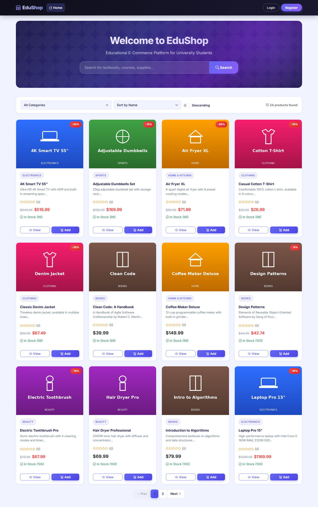

<div align="center">

# EduShop Playwright TypeScript Automation

### Browser journeys, API checks, and reproducible bug investigations for EduShop


[](https://github.com/QA-Dalil/EduShop-Playwright-TypeScript-Automation/actions/workflows/playwright.yml)

</div>

## Overview

This project tests the real [EduShop](https://github.com/BayanAlhassoun/E-Commerce-test-project-for-API---JMeter---Automation) Angular storefront and ASP.NET Core API with Playwright and TypeScript. Its **68 automated checks** cover authentication, catalog browsing, cart, checkout, orders, wishlist, reviews, and admin permissions. The [coverage map](TEST_COVERAGE.md) lists the remaining scenarios.

**Verified local run:** 68 passed (47 API, 21 browser) against EduShop in Docker; TypeScript typecheck passed. A separate [bug investigation](BUG_REPORT.md) reproduced four defects. Those deliberately failing checks are kept out of the main CI suite. The Actions badge will show CI status after this repository is published to GitHub.

## Test flow

```text
Start EduShop in Docker → verify public catalog and API → sign in as customer
→ add and update cart items → place an order → verify order history
→ check wishlist and reviews → verify admin and customer permissions
```

Playwright uses a new browser context per UI test, one worker for the shared seeded customer, and API cleanup for temporary cart, wishlist, review, and product data. The checkout journey creates a real order. Screenshots, video, and traces are retained on failure; the HTML report is uploaded by GitHub Actions.

## Run locally

1. Install Node.js 22+ and Docker Desktop with Linux containers.
2. Start [EduShop](https://github.com/BayanAlhassoun/E-Commerce-test-project-for-API---JMeter---Automation) from its own checkout with `docker compose up --build -d`. Wait for `http://localhost:4200` and `http://localhost:5000/api/product`.
3. Use a disposable seeded database. Checkout tests create orders and reduce inventory.
4. In this repository, run:

```bash
npm ci
npx playwright install chromium
npm run typecheck
npm test
npm run report
```

Run a subset or the separate bug reproductions:

```bash
npm run test:ui
npm run test:api
npm run test:bugs
```

`npm run test:bugs` currently exits with four failures because it asserts the correct behavior where EduShop has confirmed bugs. Its separate HTML report is written to `bug-report/`. This suite creates a four-product order and consumes inventory; run it on a disposable database.

Optional environment variables: `EDUSHOP_UI_URL`, `EDUSHOP_API_URL`, `EDUSHOP_CUSTOMER_EMAIL`, and `EDUSHOP_CUSTOMER_PASSWORD`. The default URLs are `http://localhost:4200` and `http://localhost:5000`. The default customer is EduShop's seeded demo account.

## Evidence

| Catalog | Product detail |
| --- | --- |
|  |  |

Regenerate these read-only screenshots with `npm run capture:evidence` while EduShop is running. The successful local HTML report is generated but ignored by Git; CI uploads it as an artifact after each run, including failures.

## Structure

```text
tests/api/                        API behavior, contracts, and permissions
tests/ui/                         Browser journeys
tests/bugs/                       Separate bug reproductions
tests/support/                    Shared authentication and data helpers
scripts/capture-evidence.mjs      README screenshot capture
docs/images/                      Screenshots from the verified run
.github/workflows/playwright.yml  Docker-based GitHub Actions pipeline
playwright.config.ts              Main projects and HTML reporter
playwright.bugs.config.ts         Separate bug investigation reporter
TEST_COVERAGE.md                  Coverage map and next scenarios
BUG_REPORT.md                     Expected vs actual bug evidence
```

## Notes

- The workflow checks out the public EduShop source separately, starts PostgreSQL, API, and UI with Docker Compose, then runs the suite on every push and pull request.
- The workflow uses EduShop's current default branch. Pin its checkout to a commit in `.github/workflows/playwright.yml` for reproducible historical runs.
- EduShop offers Card, PayPal, BankTransfer, and CashOnDelivery in the checkout form. The journey checks order placement with CashOnDelivery; it does not test a payment gateway.
- Related project: [EduShop Selenium Java Automation](https://github.com/QA-Dalil/EduShop-Selenium-Java-Automation).
